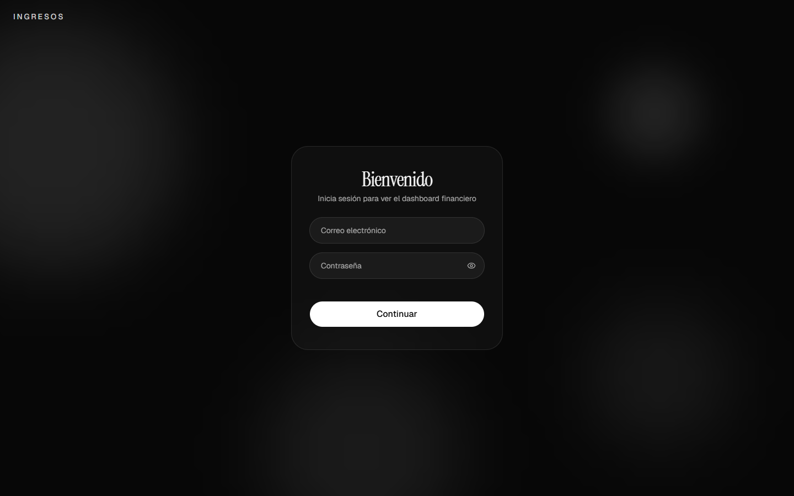
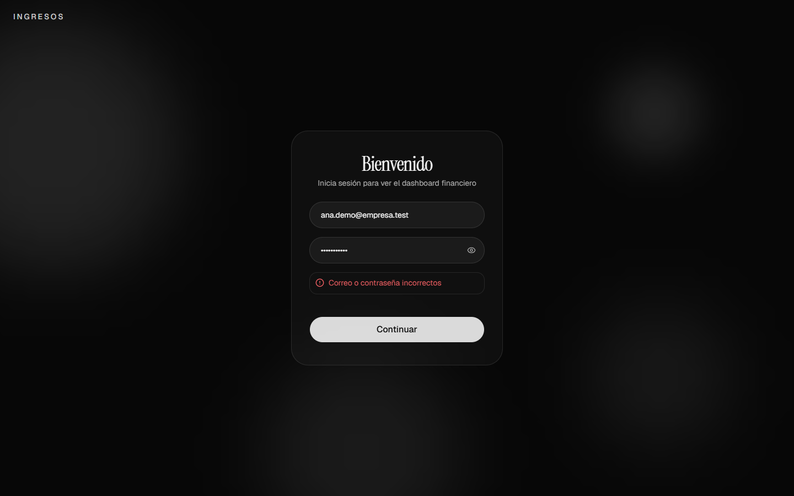
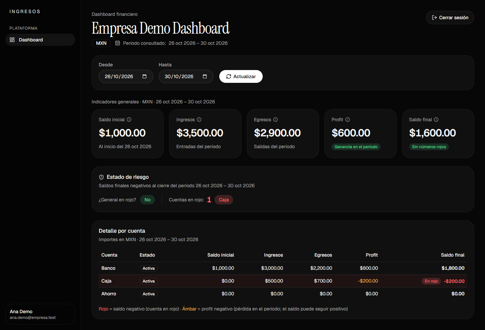
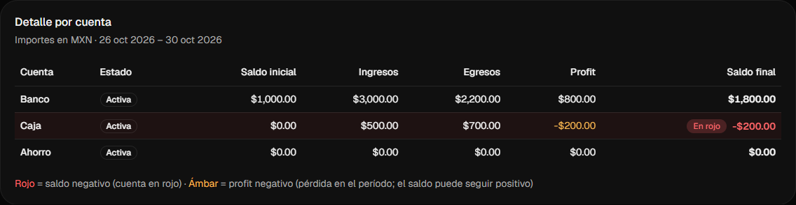
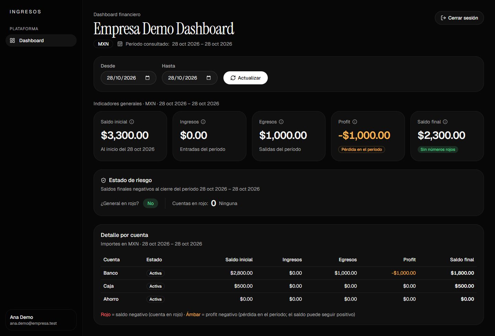
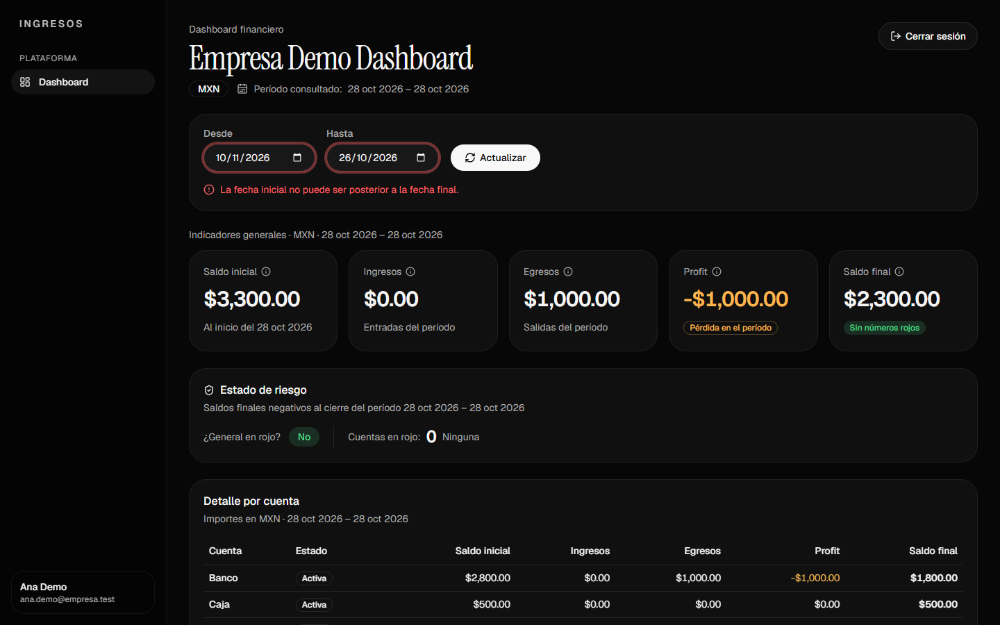
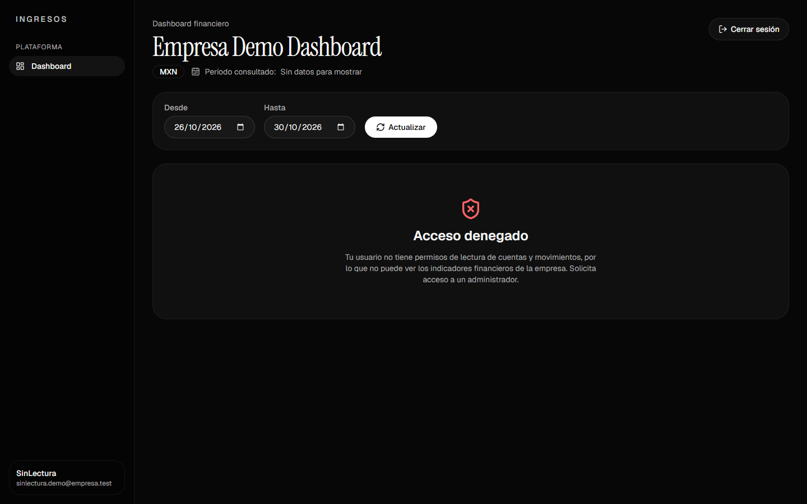
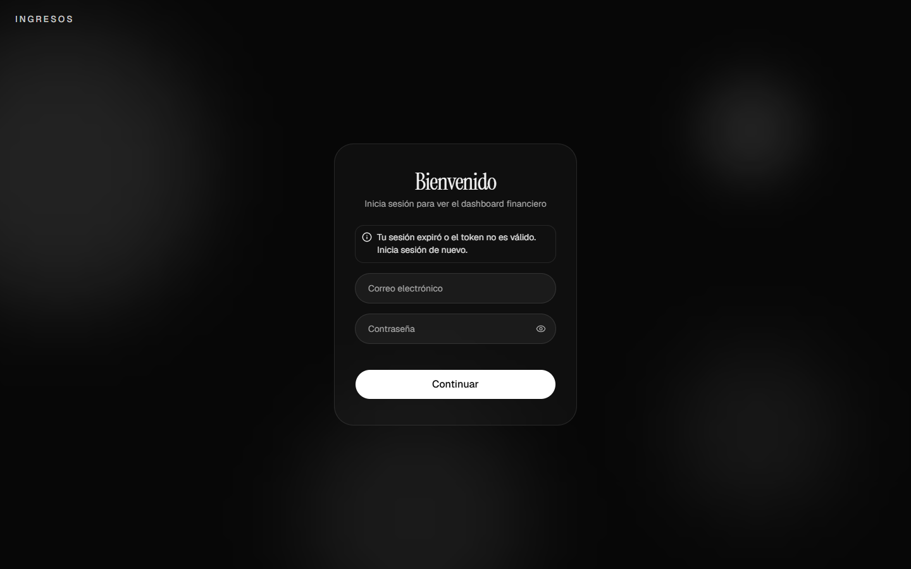
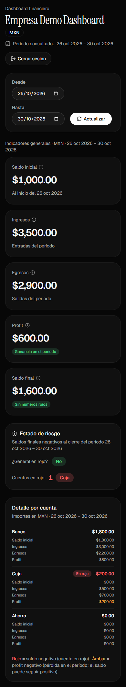

# Evidencias — Dashboard financiero (Unidad III · Actividad 1)

Capturas tomadas con Chrome (Playwright) contra el API real del equipo (`http://localhost:8004/graphql`, PostgreSQL en
Docker) con los datos de `python pruebas/unidad3_actividad1_datos.py`. Ventana de 1440×900, salvo la captura móvil (390×844).

| # | Captura | Punto de la lista de revisión (sección 7 / entrega sección 6) |
|---|---------|------------------------------------------------|
| 1 | Login | El dashboard inicia sesión con la mutación real `login` |
| 2 | Login con error | Mensaje claro si el login falla |
| 3 | Indicadores generales | Saldo inicial, ingresos, egresos, profit, saldo final, `isInRed`, `accountsInRed` |
| 4 | Detalle por cuenta | El detalle coincide con `accounts`; cuenta en rojo con total positivo |
| 5 | Cambio de fechas | Al cambiar fechas se vuelve a consultar y cambian números y etiquetas |
| 6 | Fechas inválidas | Mensaje claro si las fechas son inválidas, sin llamar al API |
| 7 | Sin permiso | Un usuario sin permiso de lectura no ve datos ni totales inventados (caso de error) |
| 8 | Token inválido | Mensaje claro si el token falló; regreso al login (caso de error) |
| 9 | Móvil | La pantalla se lee en móvil sin desbordes |

## 1. Login



Pantalla de inicio de sesión. Al enviar se llama a `login(input: {email, password}) { token tokenType user { id name email } }`
y solo con el token recibido se entra al dashboard.

## 2. Login con contraseña incorrecta



Con `ana.demo@empresa.test` y una contraseña equivocada el backend responde `"Correo o contraseña incorrectos"` y el
formulario lo muestra tal cual.

## 3. Indicadores generales (período de demo)



Período 26–30 oct 2026: 1,000.00 · 3,500.00 · 2,900.00 · 600.00 · 1,600.00 MXN, "¿General en rojo?: No" y "Cuentas en
rojo: 1 (Caja)". El encabezado muestra el nombre de la empresa (`company.name`), MXN y el período. Coincide con la sección 3.7.

## 4. Detalle por cuenta



La tabla reproduce `generalBalance.accounts`: Caja termina en −200.00 con la etiqueta "En rojo" mientras el saldo general
es +1,600.00. El profit negativo (−200.00) va en ámbar; el saldo negativo, en rojo con etiqueta.

## 5. Cambio de fechas



Con 28 oct – 28 oct 2026 y "Actualizar" se vuelve a pedir `generalBalance`: saldo inicial 3,300.00, egresos 1,000.00,
profit −1,000.00 (ámbar), saldo final 2,300.00 y ninguna cuenta en rojo (ese día Caja aún tiene 500.00). Todas las
etiquetas muestran el nuevo período.

## 6. Fechas inválidas



Con "Desde" posterior a "Hasta" aparece "La fecha inicial no puede ser posterior a la fecha final." y no se llama al API;
los datos visibles siguen rotulados con el período que realmente se consultó. (Si llegara al backend, respondería
`fromDate no puede ser posterior a toDate`.)

## 7. Usuario sin permiso



`sinlectura.demo@empresa.test` (rol `DEMO_SIN_LECTURA`, solo `concepts.read`) inicia sesión, pero `generalBalance` responde
`Permiso denegado: el rol DEMO_SIN_LECTURA no tiene el permiso accounts.read`: se muestra "Acceso denegado" y ningún importe (ni ceros).

## 8. Token inválido



Se alteró la firma del token guardado en `sessionStorage` y se recargó: el backend responde `El token no es válido o ya
venció`, el dashboard borra la sesión y regresa al login con "Tu sesión expiró o el token no es válido. Inicia sesión de nuevo.".

## 9. Vista móvil



A 390 px las tarjetas se apilan y el detalle por cuenta se muestra como lista, sin desplazamiento horizontal (0 px medidos).

## Respaldo: respuesta real de `generalBalance`

`curl` a `http://localhost:8004/graphql` con `Authorization: Bearer <token de ana.demo@empresa.test>` y variables
`{"from": "2026-10-26", "to": "2026-10-30"}` (la misma `query IndicadoresEmpresa` que usa el dashboard). Los números de
las capturas 3 y 4 son exactamente estos valores con separador de miles:

```json
{
    "data": {
        "generalBalance": {
            "companyId": "32",
            "currency": "MXN",
            "fromDate": "2026-10-26",
            "toDate": "2026-10-30",
            "openingBalance": "1000.00",
            "totalIncome": "3500.00",
            "totalExpense": "2900.00",
            "profit": "600.00",
            "closingBalance": "1600.00",
            "isInRed": false,
            "accountsInRed": 1,
            "accounts": [
                {
                    "accountId": "62",
                    "accountName": "Banco",
                    "isActive": true,
                    "openingBalance": "1000.00",
                    "totalIncome": "3000.00",
                    "totalExpense": "2200.00",
                    "profit": "800.00",
                    "closingBalance": "1800.00",
                    "isInRed": false
                },
                {
                    "accountId": "63",
                    "accountName": "Caja",
                    "isActive": true,
                    "openingBalance": "0.00",
                    "totalIncome": "500.00",
                    "totalExpense": "700.00",
                    "profit": "-200.00",
                    "closingBalance": "-200.00",
                    "isInRed": true
                },
                {
                    "accountId": "64",
                    "accountName": "Ahorro",
                    "isActive": true,
                    "openingBalance": "0.00",
                    "totalIncome": "0.00",
                    "totalExpense": "0.00",
                    "profit": "0.00",
                    "closingBalance": "0.00",
                    "isInRed": false
                }
            ]
        }
    }
}
```
